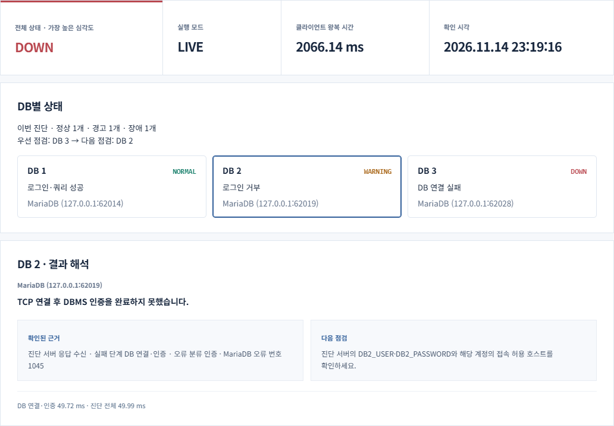

# DBMS 네트워크 접속 진단 통신 시스템

브라우저에서 진단을 요청하면 Python TCP 서버가 **최대 3개의 MariaDB를 병렬 점검**하고, DB별 연결·인증·기본 쿼리 결과와 다음 점검 항목을 반환하는 통신 시스템입니다.

## 현재 구현

- LIVE: 실제 MariaDB 연결·로그인·`SELECT 1` 실행 및 시간 측정
- DB 1·2·3의 상태 카드와 상세 원인·다음 점검 항목 표시
- DB 카드 선택 시 상단 상태·색상·상세 설명 전환, 전체 상태는 별도 유지
- 대표 상태는 `DOWN > WARNING > NORMAL` 우선순위로 선택
- DEMO: 정상·지연 경고·접속 실패 및 **DB 3개 혼합 상태** 시연
- 세션 ID 확인, UTF-8 JSON, 4바이트 길이 헤더, 입력 검증·시간 제한
- TCP 패킷 분석 도구, 자동 테스트, 노트북 클라이언트 실행·패키징 도구

DEMO도 실제 TCP로 통신하지만 DB 결과는 모의 데이터입니다. DEMO의 지연 경고는 실제 네트워크 지연을 주입한 결과가 아닙니다. 실제 DB 상태는 LIVE로 확인합니다.



## 클라이언트–서버 구조

```text
브라우저 ── HTTP ── Python 웹/TCP 클라이언트 ── TCP/JSON ── 진단 서버
                                                              ├─ MariaDB 1
                                                              ├─ MariaDB 2
                                                              └─ MariaDB 3
```

브라우저는 HTTP 클라이언트입니다. Python 웹 프로그램이 HTTP 서버와 TCP 클라이언트 역할을 함께 수행합니다. 직접 구현한 진단 서버는 요청·세션을 처리하고, DB마다 별도 연결을 만들어 병렬 점검합니다. TCP/IP는 운영체제의 스택을, DB 접근은 PyMySQL을 사용합니다.

## 빠른 실행: DB 설치 없는 DEMO

**Python 3.14.3 이상**이 필요합니다. Windows에서는 저장소를 내려받아 전체 압축 해제한 뒤 루트의 **`01_프로그램_실행.cmd`를 더블클릭**하세요. TCP 진단 서버와 웹 클라이언트를 함께 시작하고 브라우저를 엽니다. DEMO는 표준 라이브러리만 사용하므로 MariaDB·PyMySQL 설치가 필요하지 않습니다.

Python이 없다면 [공식 Windows 다운로드](https://www.python.org/downloads/windows/)에서 먼저 설치합니다. 실행 도구는 Python 소스를 시작하는 CMD/BAT이며 Python이 포함된 단독 EXE는 아닙니다. Python 준비 후 DEMO 실행에는 인터넷이 필요하지 않습니다.

`02_결과비교/`에는 **정상·지연 경고·접속 실패 BAT 3개**가 있습니다. 선택한 모의 결과를 자동 진단하며 실제 DB 상태·비밀번호는 변경하지 않습니다. 실행 창을 유지하고 종료 시 Enter 또는 Ctrl+C를 누릅니다. 기본 포트가 사용 중이면 빈 포트를 선택하며 기존 프로세스를 종료하지 않습니다. 이 실행 도구는 DEMO 전용이고 LIVE는 아래 별도 설정 절차를 사용합니다.

명령줄에서도 실행할 수 있습니다.

```powershell
python -B start_demo.py
python -B start_demo.py --scenario warning --auto-run
python -B start_demo.py --self-test
```

최신 프로그램은 저장소 상단 **Code → Download ZIP**으로 내려받아 전체 압축 해제하거나 `git clone`으로 받습니다. 이 저장소는 소스코드·실행 도구·검증자료를 관리하며 발표 PPT와 보고서는 별도로 보관합니다.

서버와 웹 클라이언트를 따로 실행하려면 터미널 두 개를 사용합니다.

첫 번째 터미널 — 진단 서버:

```powershell
python -B -m app.server --host 127.0.0.1 --port 62036
```

두 번째 터미널 — 웹 클라이언트:

```powershell
python -B -m app.web_client --host 127.0.0.1 --port 62039
```

1. 브라우저에서 <http://127.0.0.1:62039/> 접속
2. 진단 서버 주소 `127.0.0.1`, 포트 `62036` 입력
3. **DEMO → DB 3개 · 혼합 상태 → 진단 시작** 선택
4. NORMAL·WARNING·DOWN을 비교하고 각 DB 카드를 눌러 상단 상태·상세 내용 확인. 전체 상태와 왕복 시간은 같은 진단 요청의 값으로 유지

명시적으로 지정하지 않은 CLI 기본 포트는 진단 서버 `9090`, 웹 `8080`입니다. 위 `62036`·`62039`는 최종 캡처와 맞춘 실행 예시이며, 다른 포트를 쓰면 웹 입력과 캡처 필터도 함께 맞춰야 합니다.

## 실제 MariaDB 1~3개 점검

```powershell
python -m pip install -r requirements.txt
```

실행 중인 MariaDB와 점검 계정을 준비한 뒤, **진단 서버를 실행할 터미널**에 접속 정보를 설정합니다. 아래는 DB 1의 예시입니다. 암호는 직접 입력하고 저장소에 저장하지 않습니다.

```powershell
$env:DB_HOST = '127.0.0.1'
$env:DB_PORT = '3307'
$env:DB_USER = 'course_monitor'
$env:DB_NAME = 'course_network_demo'
$env:DB_PASSWORD = [System.Net.NetworkCredential]::new('', (Read-Host 'DB 1 암호' -AsSecureString)).Password
python -B -m app.server --host 127.0.0.1 --port 62036
```

DB 2·3도 점검하려면 서버 시작 전에 아래 접두사의 환경변수를 각각 설정합니다.

| 대상 | 접속 설정 |
|---|---|
| DB 1 | `DB_HOST`, `DB_PORT`, `DB_USER`, `DB_PASSWORD`, 선택적으로 `DB_NAME` |
| DB 2 | `DB2_HOST`, `DB2_PORT`, `DB2_USER`, `DB2_PASSWORD`, 선택적으로 `DB2_NAME` |
| DB 3 | `DB3_HOST`, `DB3_PORT`, `DB3_USER`, `DB3_PASSWORD`, 선택적으로 `DB3_NAME` |

여러 MariaDB 프로세스를 같은 PC에서 실행할 때는 각 데이터 디렉터리와 수신 포트를 분리해야 합니다. 주소·계정·포트는 실제 준비된 환경에 맞춥니다. 환경변수를 바꿨다면 진단 서버를 다시 실행합니다. 브라우저에서 LIVE를 선택해 진단합니다.

| 상태 | 의미 |
|---|---|
| NORMAL | 로그인·SELECT 1 성공, 지연 기준 이내 |
| WARNING | 인증·설정·쿼리 문제 또는 성공 후 지연 기준 초과 |
| DOWN | DB 연결 실패·시간 초과 등 |

기본 지연 경고 기준은 **500ms 초과**, DB 연결·읽기·쓰기 제한은 각각 **3초**입니다. 변경할 때는 `DB_WARNING_MS`, `DB_CONNECT_TIMEOUT_SECONDS`, `DB_READ_TIMEOUT_SECONDS`, `DB_WRITE_TIMEOUT_SECONDS`를 사용합니다. 상태 색만으로 원인을 단정하지 말고 실패 단계·오류 종류·오류 번호를 함께 확인합니다.

`scripts/install_local_course.ps1`과 `start_local_live.ps1`은 Windows의 로컬 **단일 MariaDB(3307)** 설치·실행 도구입니다. DB 3개를 자동 설치하는 도구는 아닙니다. 기존 DB와 분리된 환경에서 사용합니다. DB 로그인 성공과 `SELECT 1` 성공이 업무 서비스 전체의 정상을 보장하지는 않습니다.

## 최종 실행 자료와 Wireshark

[최종 실행 증빙](evidence/final-20261114/)은 2026-11-14 한 PC의 루프백에서 실행한 자료입니다. 원본 `final-run.pcapng`, 화면, 포트·결과 JSON과 대조 기록을 함께 보관합니다.

| LIVE 대상 | 결과 | 총 진단 시간 |
|---|---|---|
| DB 1 | NORMAL, 로그인·SELECT 1 성공 | 50.39ms |
| DB 2 | WARNING, 인증 거부 1045 | 49.99ms |
| DB 3 | DOWN, 연결 실패 2003 | 2,057.53ms |

세 DB의 정상 동작을 먼저 확인한 뒤 DB 2의 임시 계정 암호를 변경하고 DB 3을 중지한 실험입니다. 현재 PC에서 같은 오류가 항상 발생한다는 의미는 아닙니다. DEMO 혼합 상태도 같은 캡처에 포함되며 LIVE와 구분됩니다.

Wireshark에서 다음 표시 필터로 확인합니다.

```text
tcp.stream == 0 && frame.number <= 3
frame.number in {8,10,12,15,16,17,104}
frame.number in {121,123}
```

- 1·2·3번: 진단 연결의 SYN → SYN/ACK → ACK
- 10·12·15번: 진단 서버에서 DB 1로 여는 별도 TCP 연결
- 16·17번: DB 3 첫 연결 시도와 RST/ACK
- 104번: LIVE DB별 결과 반환, 121·123번: DEMO 혼합 요청·응답
- `response-check.json`: 캡처의 응답과 화면 결과 대조 기록

```powershell
python -B -m scripts.check_packet_evidence --capture evidence/final-20261114/final-run.pcapng --diagnostic-port 62036 --db-port 62014
```

TShark가 PATH에 없으면 `--tshark 'C:\Program Files\Wireshark\tshark.exe'`를 추가합니다. 저장소 루트의 기존 2026-10-05 PCAPNG 두 개는 자동 테스트와 과거 실험을 위한 자료이므로 유지합니다. 그 패킷 번호를 최종 캡처의 번호와 혼용하지 않습니다.

## OSI 7계층

| 계층 | 프로그램과의 연결 및 관찰 범위 |
|---|---|
| 7 응용 | 진단 요청·응답, DB 로그인·기본 쿼리 결과 해석 |
| 6 표현 | JSON 직렬화와 UTF-8 인코딩·복원 |
| 5 세션 | 연결별 세션 ID 발급·확인·종료 |
| 4 전송 | TCP 소켓, 포트, SYN/SYN-ACK/ACK, Seq/Ack |
| 3 네트워크 | 출발지·목적지 IPv4, 진단 서버 구간과 DB 구간 구분 |
| 2 데이터링크 | 최종 캡처는 NULL/Loopback. 실제 Ethernet MAC 프레임 검증과 구분 |
| 1 물리 | 루프백은 외부 케이블·Wi-Fi를 통과하지 않음. 실제 매체 검증은 별도 LAN 실험 필요 |

5·6계층은 응용 프로그램의 기능을 OSI 역할에 대응시킨 설명입니다. 4바이트 길이 헤더도 응용 메시지 경계를 위한 규약입니다. 최종 루프백 실험이나 Tailscale 원격 실험을 물리 LAN의 1·2계층 검증으로 서술하지 않습니다.

## 테스트와 협업 자료

```powershell
python -B -m unittest discover -s tests -v
```

Node.js가 있는 개발 환경에서는 화면 선택 처리도 확인할 수 있습니다. Node.js는 프로그램 실행에 필요하지 않습니다.

```powershell
node --test tests/test_target_selection.cjs
```

- [최신 검증 기록](docs/FINAL_VALIDATION.md)
- [팀 브리핑과 남은 작업](TEAM_BRIEFING.md)
- [노트북 클라이언트·LAN 실험 준비](docs/LAPTOP_LAN_TEST.md)
- [프로그램·네트워크 용어 안내](app/static/guide.html)
- `start-laptop-client.cmd`: 노트북 웹 클라이언트 실행
- `scripts/build_laptop_client.ps1`: 노트북용 클라이언트 전용 ZIP 생성. 진단 서버는 별도로 실행

## 파일 구성과 공개 범위

| 위치 | 내용 |
|---|---|
| `01_프로그램_실행.cmd`, `start_demo.py` | 서버·웹 클라이언트를 함께 시작하는 DEMO 실행 도구 |
| `02_결과비교/` | 정상·지연 경고·접속 실패 비교용 BAT와 안내 |
| `app/` | 진단 서버·웹/TCP 클라이언트·DB 진단·화면 |
| `scripts/` | 설치·실행·패킷 검증 도구 |
| `tests/` | Python 자동 테스트와 화면 선택 회귀 검사 |
| `docs/` | 실행·네트워크 설명 및 검증 기록 |
| `evidence/` | 공유 가능한 패킷·결과·화면 증빙 |

DB 암호, `.env`, `secrets/`, MariaDB 데이터, 개인 로그, 가상환경은 올리지 않습니다. 설치 비밀번호는 실행 시 생성해 저장소 밖에 보관합니다. 진단 TCP 구간에는 별도 TLS·사용자 인증을 구현하지 않았으므로 외부에 그대로 노출하지 않고 허용된 로컬/LAN 환경에서 사용합니다. 개인 설정 파일은 저장소 밖에서 관리합니다.
